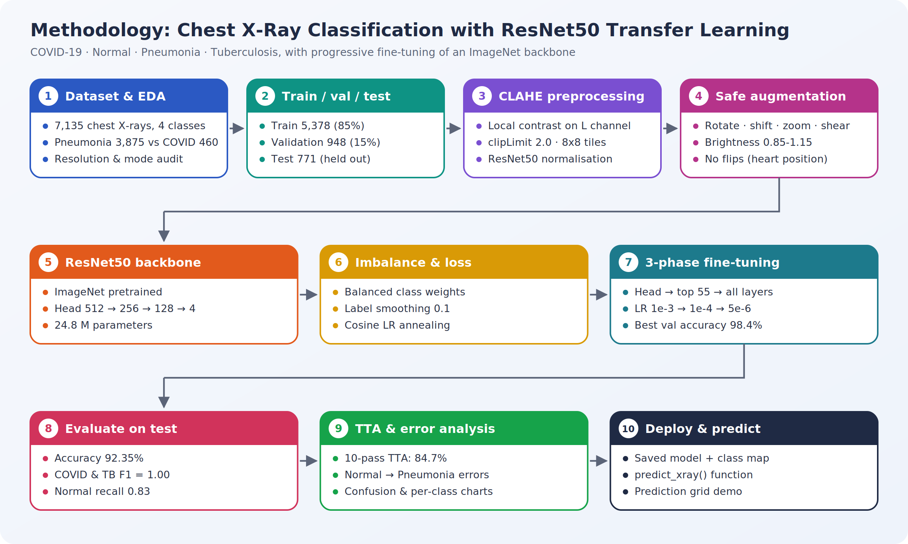
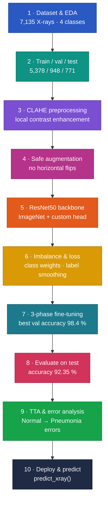
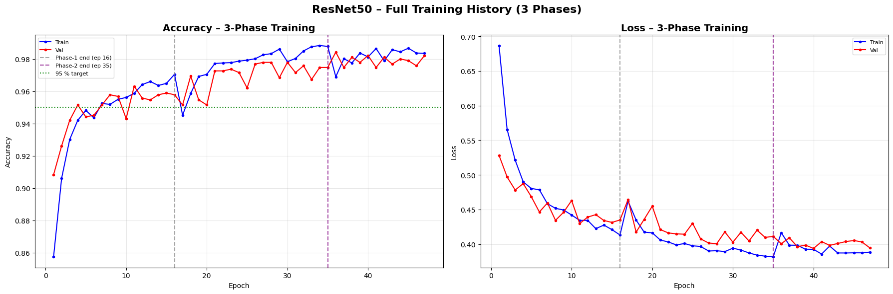
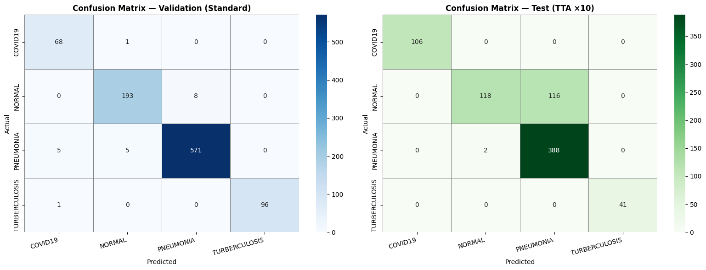
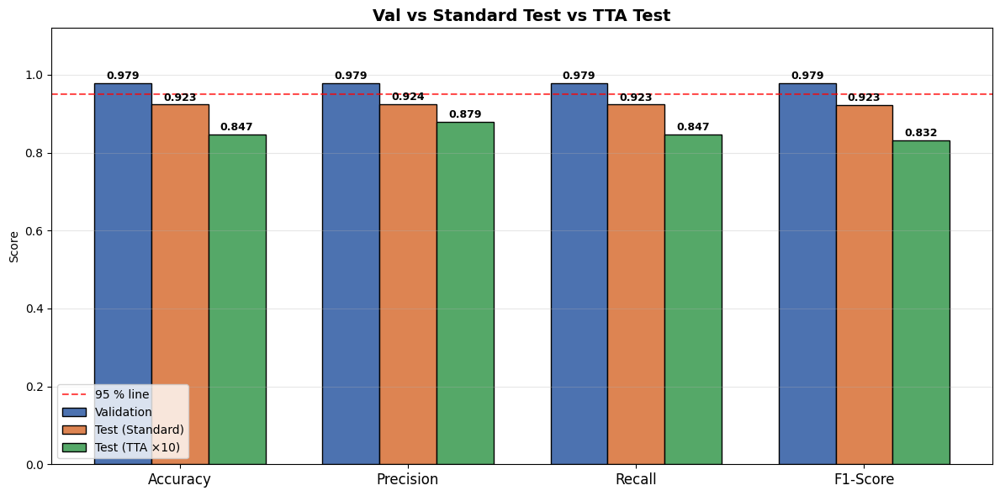

# Chest X-Ray Classification with ResNet50 Transfer Learning

Classifies chest X-rays into **COVID-19, Normal, Pneumonia and Tuberculosis** by fine-tuning an ImageNet-pretrained **ResNet50** in three progressive phases, with CLAHE contrast enhancement, medically safe augmentation and class weighting for a heavily imbalanced dataset.

> MSc Data Science group project (Machine Learning), University of Hertfordshire. All results come from one complete run on a Kaggle Tesla T4 GPU.

---

## Highlights

| | |
|---|---|
| **Test accuracy** | **92.35 %** on 771 held-out X-rays (weighted F1 0.923) |
| **Per class** | COVID-19 and Tuberculosis **F1 = 1.00**; Pneumonia 0.93; Normal 0.87 |
| **Model** | ResNet50 (ImageNet) + custom 512 → 256 → 128 → 4 head, 24.8 M parameters |
| **Training** | 3-phase progressive unfreezing (head → top 55 layers → all 185 layers), cosine LR, label smoothing |
| **Data handling** | CLAHE preprocessing, balanced class weights, no horizontal flips (preserves heart position) |
| **Deployment** | Saved model + class map and a reusable `predict_xray()` function |

## Methodology

**[Explore the interactive methodology](https://spoorthihs4-ops.github.io/chest-xray-resnet50-transfer-learning/)** – click any stage to see what it does, why it matters, the result it produced and the techniques behind it.

<b>Pipeline as a live diagram (zoom and pan on GitHub)</b>

## Results

### Test set (771 held-out images)

| Class | Precision | Recall | F1 | Support |
|---|---|---|---|---|
| COVID-19 | 1.00 | 0.99 | 1.00 | 106 |
| Tuberculosis | 1.00 | 1.00 | 1.00 | 41 |
| Pneumonia | 0.90 | 0.95 | 0.93 | 390 |
| Normal | 0.91 | 0.83 | 0.87 | 234 |
| **Weighted average** | **0.924** | **0.924** | **0.923** | 771 |

| Phase | Layers trained | Learning rate | Best validation accuracy |
|---|---|---|---|
| 1 | Head only (backbone frozen) | 1e-3 | 96.31 % |
| 2 | Top 55 ResNet50 layers + head | 1e-4 | 97.78 % |
| 3 | All 185 layers | 5e-6 | **98.42 %** |

**Key findings**
- **Normal vs Pneumonia is the hard boundary.** About 17 % of Normal X-rays are predicted as Pneumonia, a known challenge because early pneumonia can look like a healthy lung.
- **Test-time augmentation hurt.** 10-pass TTA scored 84.70 % because Normal recall fell from 0.83 to 0.50, so the standard prediction is reported.
- **Validation is optimistic.** Validation images come from the training folder, so the 98.4 % validation score overstates performance; the 92.35 % held-out test score is the realistic estimate.

  

  
  

## Notebooks

| Notebook | Contents |
|---|---|
| [`00_full_pipeline_run_all`](00_full_pipeline_run_all.ipynb) | **Everything, top to bottom - run this to reproduce** |
| [`01_dataset_exploration`](01_dataset_exploration.ipynb) | Dataset download, structure, summary statistics, image sizes, class distribution, sample X-rays |
| [`02_transfer_learning_model`](02_transfer_learning_model.ipynb) | Why ResNet50, configuration, CLAHE and augmentation, class weights, model architecture |
| [`03_three_phase_fine_tuning`](03_three_phase_fine_tuning.ipynb) | Cosine LR schedule, three training phases, combined training curves |
| [`04_evaluation_and_tta`](04_evaluation_and_tta.ipynb) | Validation and test metrics, TTA, confusion matrices, per-class and comparison charts |
| [`05_deployment_and_summary`](05_deployment_and_summary.ipynb) | Save and reload the model, `predict_xray()`, prediction grid, summary and reflection |

## Reproduce

1. Open [`00_full_pipeline_run_all.ipynb`](00_full_pipeline_run_all.ipynb) on **Kaggle** with a **GPU T4** accelerator and Internet enabled.
2. The dataset [`jtiptj/chest-xray-pneumoniacovid19tuberculosis`](https://www.kaggle.com/datasets/jtiptj/chest-xray-pneumoniacovid19tuberculosis) downloads automatically through `kagglehub`.
3. **Run All.** Each training epoch takes about 2.5-4 minutes on a T4 (longer once all layers are unfrozen).

## Limitations

- The validation subset is drawn from the training folder and also receives augmentation, so validation scores are optimistic and slightly noisy.
- Images may include several per patient; without patient IDs, a patient-level split cannot be guaranteed.
- This is a research prototype and is **not** a diagnostic tool.

## Contributors

Group project. Add team members and your own role here.

**Dr. Spoorthi H S** · MSc Data Science, University of Hertfordshire  
[LinkedIn](https://linkedin.com/in/dr-spoorthi-2005b6351) · [GitHub](https://github.com/spoorthihs4-ops)
